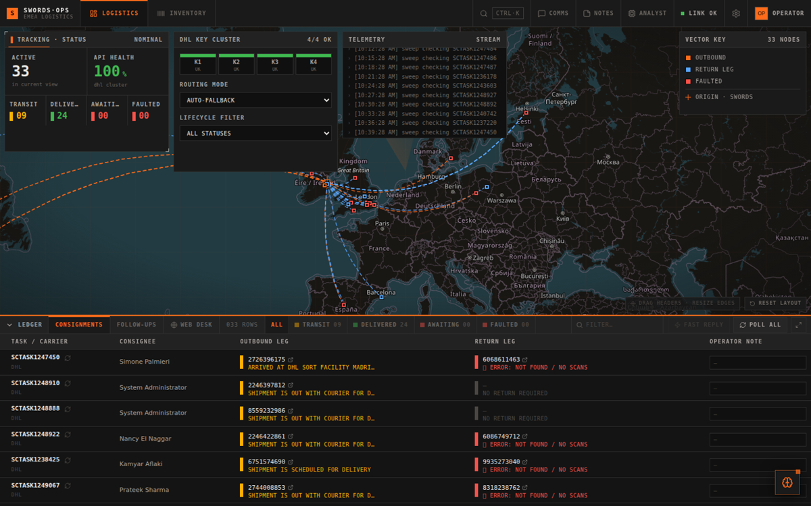
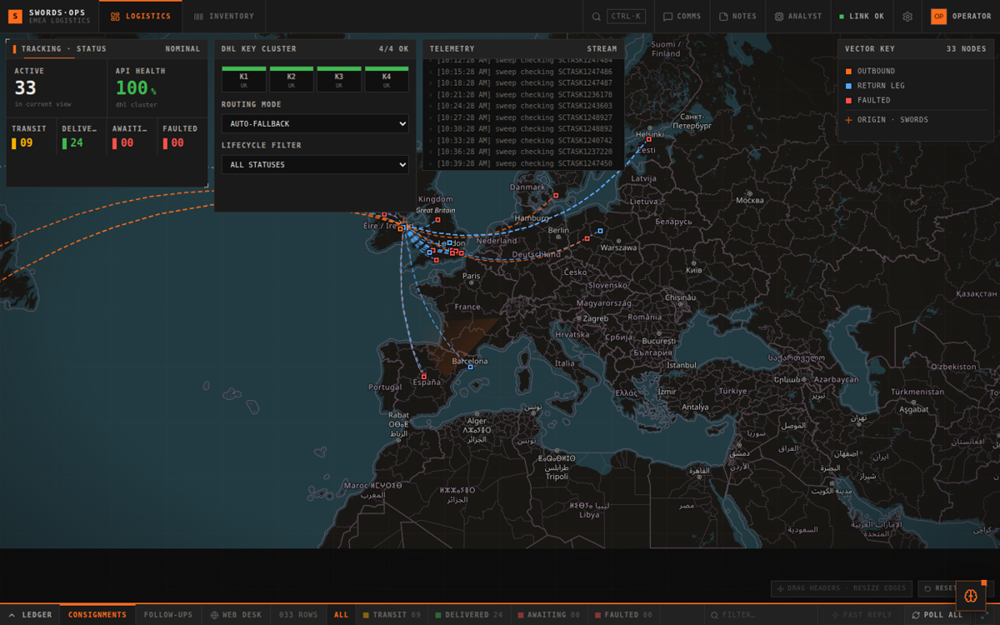
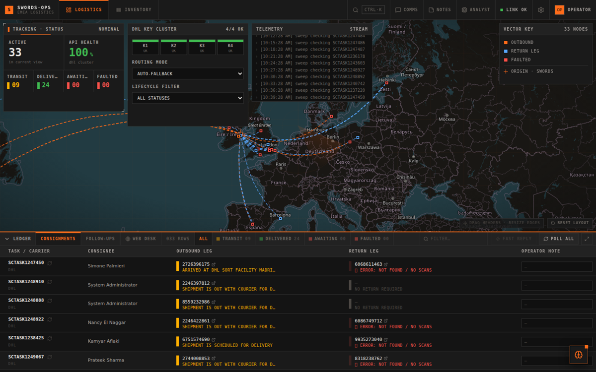
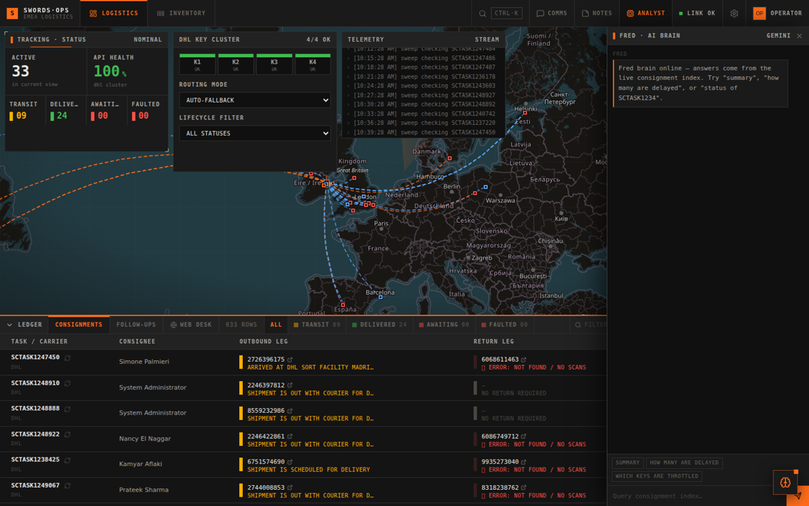
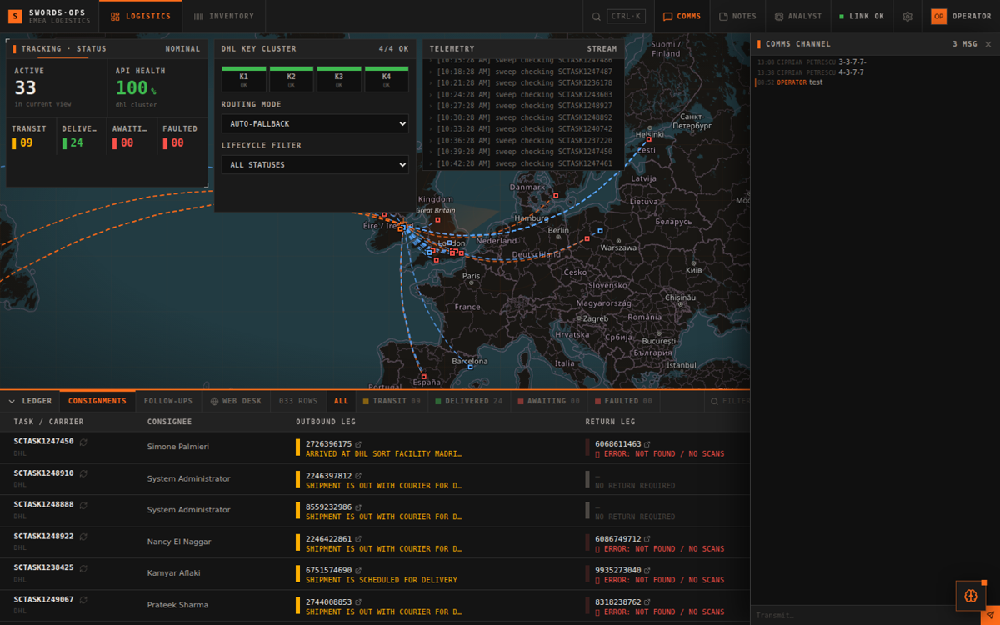
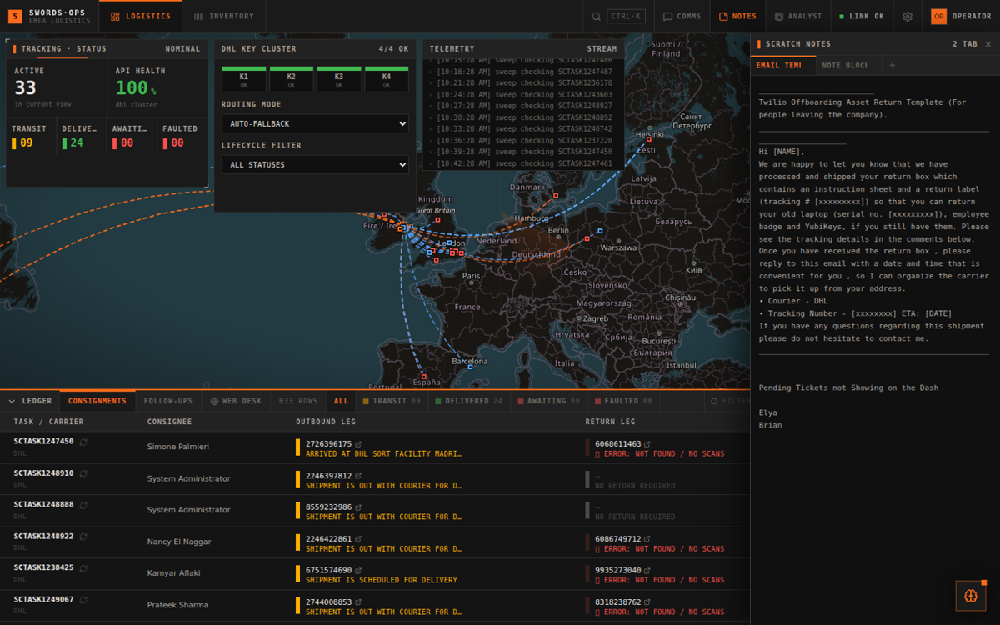
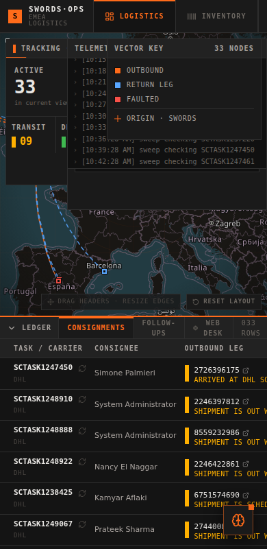

# Track Logistics

**An operations console for outbound and return shipments across two courier networks - manifest ingest, live tracking-state resolution, an operator note journal, and a stock-reconciliation scanner, in one dashboard.**

[](#status)
[](#architecture)
[](#persistence)
[](#licence)

---

## What it is

A single-page operations desk for a hardware logistics workflow where devices move in two directions: a replacement unit goes out, the faulted unit comes back. Each movement is owned by a ticket reference, tracked on two different courier APIs with two different authentication models and two different status vocabularies, and reconciled at the end of the month against a stock count.

Doing that by hand means keeping a browser tab per carrier, a spreadsheet per manifest, and a text file per shift. This collapses all three into one view: a live ledger of every consignment, a status colour that reflects the true state of both legs, a note field that survives the next manifest re-upload, and a deterministic rule engine that answers operator questions from the state it already holds.

Nothing here talks to a ticketing system, an HR system, or a cloud console. It reads a workbook out of a download folder and a tracking number off an API.

> **Notice.** This repository is a sanitised copy of an internal tool. Carrier names, endpoints, credentials, employer names and ticket references have been replaced with neutral placeholders, and the runtime state files ship as empty samples. See [Sanitisation](#sanitisation) for the exact substitutions - the table there is complete and nothing else was altered.

---

## Screenshots



*Command view - status tile readouts, the consignment map, the courier API-key health strip and the operator log tail.*



*The ledger - one row per consignment, colour-coded by the resolved state of the outbound leg, with inline notes and per-row refresh.*



*Consignment detail - both legs of a movement side by side, with the latest scan event and the resolved status for each carrier.*



*Operator journal - free-text notes attached to a ticket reference, and the follow-up queue for shipments that need a human.*



*Comms desk - template-driven customer replies built from the consignment state, with a fast-reply mode for one-line updates.*



*Shift notes - the running log of what changed during a shift, kept alongside the ledger rather than in a separate file.*



*Phone view - the console is usable from a handset for reading state and firing a fast reply while away from the desk.*

---

## Architecture

```
                   +--------------------------+
   Downloads/      |  chokidar                |
   |- *manifest*    |  filename-driven ingest  |--+
   |- *courier-b*   +--------------------------+  |
   +- *inventory*                                 |
                                                  v
   +--------------+   parse + normalise   +---------------------+
   |  xlsx / csv  | ---------------------> |  in-memory ledger   |
   +--------------+                        |  + JSON persistence |
                                           +----------+----------+
                                                      |
             +----------------------------------------+-----------------------+
             v                                        v                       v
    +-----------------+                    +------------------+    +------------------+
    | Courier A API   |                    | Courier B API    |    | Geocoder         |
    | API-key pool    |                    | OAuth2 client    |    | forward lookup   |
    | 429 -> park key |                    | credentials      |    | for map pins     |
    +-----------------+                    +------------------+    +------------------+
             |                                        |                       |
             +-------------------+--------------------+-----------------------+
                                 v
                    +--------------------------+
                    |  Express API  /api/*     |
                    +------------+-------------+
                                 v
                    +--------------------------+
                    |  React SPA (Vite build)  |
                    |  ledger . map . scanner  |
                    +--------------------------+
```

Two processes. The Express server owns ingest, carrier polling and state; the React front end polls `/api/state` on an interval and renders from that. There is no database and no message broker - the working set fits in memory and is mirrored to flat JSON so a restart does not lose the shift.

### The two couriers are genuinely different problems

The interesting part of this build is that the two networks do not behave alike, and the code does not pretend they do.

| | Courier A | Courier B |
|---|---|---|
| Authentication | Static API key in a request header | OAuth2 client-credentials, bearer token per call |
| Quota model | Hard per-key rate limit, returns 429 | Token-scoped, effectively unthrottled at this volume |
| Failure signal | 429 = quota exhausted, 404 = nothing scanned yet | Error object inside a 200 response body |
| Location field | `address.addressLocality` on the status node | `latestStatusDetail.scanLocation.city` |

**The key pool.** Courier A limits each key independently, so the server holds a pool and walks it in order. A key that answers 429 is marked `QUOTA_EXCEEDED` and removed from rotation until the operator returns the pool to `AUTO` mode, at which point every key is re-armed. When the whole pool is exhausted, auto mode resets it once before reporting failure - otherwise a single bad minute would take the dashboard down for the rest of the day.

**Status normalisation.** Neither carrier returns a string you can filter on. Courier A gives a human sentence, Courier B gives a short code plus a separate location object. Both are reduced to one internal shape before they touch the ledger:

```js
{
  carrier: 'courierA',
  ticketRef: 'TASK0000001',
  name: 'Assigned operator',
  outboundTrk: '000000000000',
  outboundStatus: 'IN TRANSIT',
  returnTrk: '-',
  returnStatus: 'No Return Required',
  location: 'Somewhere, IE',
  coords: [53.34, -6.26],
  note: '',
  rank: 1
}
```

That normalised row is the unit everything else works against - the ledger, the map, the counters, the rule engine. One shape, one place to change.

---

## Features

### Manifest ingest

A file watcher on the download directory. Drop a workbook in and it is parsed, normalised and merged. Routing is entirely filename-driven, so the operator never has to tell the dashboard what it is holding:

| Filename contains | Treated as |
|---|---|
| `manifest`, `consignment` | Courier A consignment manifest |
| `courier-b` | Courier B consignment manifest |
| `asset_export`, `inventory` | Expected-inventory export for the scanner |

Partial downloads (`.crdownload`, `.part`, `.tmp`) are ignored, and a file still being written is retried rather than parsed half-finished - a lock error on a large workbook is the normal case, not an exception.

Header matching is deliberately tolerant. These exports get re-saved by hand and the column titles drift, so the parser accepts several spellings of every field and resolves the ticket reference from whichever column it landed in. **Re-uploading a manifest does not reset carried-forward fields**: status, location, coordinates and notes are matched back onto the incoming row by ticket reference and preserved. Getting this wrong is the most damaging bug available in a tool like this, because a silent reset looks exactly like a genuine status change.

### The ledger

One row per consignment, sorted by an explicit priority rank rather than by date, because what matters is what is stuck:

| Rank | State | Meaning |
|---|---|---|
| 1 | Awaiting collection | No scan yet - the collection has not happened |
| 2 | In transit | Moving, nothing to do |
| 3 | Outbound delivered | Replacement arrived, return still outstanding |
| 4 | Closed | Both legs delivered, or no return required |
| 5 | Anything else | Neither leg resolved |

State is derived in one place (`lib/priority.js`) and every consumer reads from it - the row indicator, the filter chips and the dashboard counters all call the same function, so a row cannot be painted one colour and counted under another.

### Operator notes

Notes are keyed by ticket reference, not by row position, and live in their own store rather than inside the parsed record. That is what makes a note survive a manifest that renames a column, reorders rows, or drops the row for one upload and reinstates it in the next. The inline note cell is optimistic and reconciles against the server on blur instead of overwriting whatever the operator is currently typing.

Above the inline note sits a longer-form **case journal** - a timestamped, attributed list of entries per consignment, which is where the narrative of a stuck shipment actually lives.

### Stock reconciliation

The second module answers a different question: *is everything we expected actually here?* An expected-inventory export is loaded, serials are scanned in, and each scan is matched against the expected list. Three outcomes are tracked separately - matched, scanned-but-not-expected, and expected-but-never-scanned - because they mean different things and a single mismatch count would hide that. Results export as CSV, including a serials-only variant for handing to whoever needs the bare list.

### Email templates

Return instructions are long, repetitive and easy to get subtly wrong. The Fast Reply panel holds a template library with variable substitution - names, dates, tracking numbers, serials - and produces a formatted draft with the case values already resolved. Templates are edited in a dedicated page and persisted server-side, so they are not hostage to whichever browser the operator happens to be in.

### Rule-based assistant

There is a chat panel. It is **not** a language model. `/api/ai/chat` routes to `lib/aiRouter.js`, a deterministic intent matcher over the in-memory state. It answers questions like *what is stuck*, *what failed to scan*, *how many are still in transit*, and *what is the status of this ticket* by reading the records directly.

That is a deliberate design choice. An operator asking which consignments have no scans needs the true answer every time, not a plausible sentence, and a rule engine reading the actual state cannot invent a tracking status. The trade is that it only answers questions someone thought to implement; for anything the router does not recognise, it says so rather than guessing.

---

## Repository layout

```
track-logistics/
+-- server/
|   +-- server.js            Express app: ingest, carrier polling, API surface
|   +-- lib/
|       +-- aiRouter.js      Deterministic intent router for the chat panel
|       +-- storefiled.js    Atomic JSON file store with debounced writes
+-- web/
|   +-- src/
|   |   +-- App.jsx          Module shell, state and polling
|   |   +-- components/
|   |   |   +-- dashboard/   Command centre: tiles, map, key health, log tail
|   |   |   +-- ledger/      Consignment table, follow-ups, web desk
|   |   |   +-- scanner/     Stock reconciliation and manifest import
|   |   |   +-- fastreply/   Template library and variable substitution
|   |   |   +-- widgets/     Dockable panels (assistant, notes, chat)
|   |   |   +-- modals/      Settings, templates, profile
|   |   |   +-- layout/      Top bar, module switcher
|   |   |   +-- ui/          Panel, Button, Badge primitives
|   |   +-- hooks/           Polling, debounce, toasts, panel layout
|   |   +-- lib/             api, priority, manifest parsing, exporters, mailto
|   |   +-- styles/          Theme, map, keyframes
|   +-- package.json
+-- docs/
|   +-- ARCHITECTURE.md
|   +-- DATA-MODEL.md
|   +-- COURIERS.md
|   +-- OPERATIONS.md
|   +-- SANITISATION.md
+-- .env.example
+-- LICENSE
```

---

## API surface

| Method | Path | Purpose |
|---|---|---|
| GET | `/api/state` | Entire working set: records, logs, alerts, notes, chat, key health |
| POST | `/api/refresh-single` | Re-poll one consignment outbound and return legs |
| POST | `/api/set-api-mode` | `AUTO`, or pin the pool to one key id |
| GET | `/api/notes` | Operator note map |
| POST | `/api/save-note` | Upsert one inline note by ticket reference |
| POST | `/api/updates/add` | Append a journal entry |
| POST | `/api/updates/delete` | Remove a journal entry |
| GET/POST | `/api/templates` | Template library |
| POST | `/api/upload` | Ingest a workbook posted from the browser |
| POST | `/api/ai/chat` | Rule-based assistant query |

---

## Running it

```bash
cp .env.example .env      # fill in the keys you actually have
npm install               # server deps
npm --prefix web install  # front-end deps
npm run dev               # server + vite together
```

The server listens on `PORT` (default 5000) and serves the built front end from `web/dist`; in development Vite serves the UI and proxies to the API. Build for production with `npm --prefix web run build`.

Most of the dashboard runs with **no credentials at all** - manifest ingest, the ledger, notes, the scanner and the template library are all local. Only live tracking resolution needs carrier keys; without them, rows sit in `Pending Manual Sync` and everything else still works.

---

## Design notes

A few decisions worth stating, because these are the ones that cost time to get right:

**Match on the ticket reference, never on row position.** Every carried-forward field resolves by ticket reference. Index or row-order matching silently transfers one consignment notes and coordinates onto another the moment a manifest is re-sorted, and it does so without erroring.

**One source of truth for derived state.** Status colour, filter chips and counters all call the same function. Duplicating a classification rule across three components is how a row ends up green in the table and amber in the tile above it.

**Treat a transient 5xx as unknown, not as dead.** A carrier returning 502 or a gateway timeout during a bad minute is not evidence that a shipment does not exist. The poller keeps the last known state and flags the row rather than overwriting a real status with a failure.

**Ignore the query string when reasoning about caching.** The front end has sat behind a reverse proxy more than once; relative API paths plus a no-cache policy on the app bundle removed an entire class of *the fix did not work* problems that were really an edge cache serving yesterday JavaScript.

---

## Status

An internal tool, extracted and documented. It is not hardened for multi-tenant use: state is process-local, there is no user model, and the API assumes it sits behind an authenticating proxy. Read it as a worked example of carrier-agnostic shipment reconciliation rather than as a product.

Tested against the two carrier APIs it was written for, at a few hundred consignments per month. It has not been load-tested, and the map view degrades past a few hundred simultaneous pins because it renders every consignment rather than clustering them.

---

## Sanitisation

Because this came out of a real environment, the published copy differs from the running copy in exactly these ways and no others:

| Was | Is now |
|---|---|
| Courier A brand and API hostname | `CourierA`, `api.courier-a.example` |
| Courier B brand and API hostname | `CourierB`, `apis.example-courier.com` |
| Employer name in mail templates | `ACME` |
| Corporate mail domain | `[returns mailbox]` |
| Ticketing platform name and instance | `Ticket queue`, `ticket-queue.example.com` |
| Four carrier API keys | `COURIER_API_KEYS`, comma-separated |
| Courier B OAuth2 client id and secret | `COURIER_CLIENT_ID` / `COURIER_CLIENT_SECRET` |
| Geocoding API key | `GEOCODE_API_KEY` |
| Basic-auth password literal | `change-me` (dead code path) |
| Live state files | Empty `.sample.json` equivalents |
| Sample workbooks | Not included |

Logic, structure, module layout and comments are unchanged.

---

## Licence

MIT - see [LICENSE](LICENSE).
